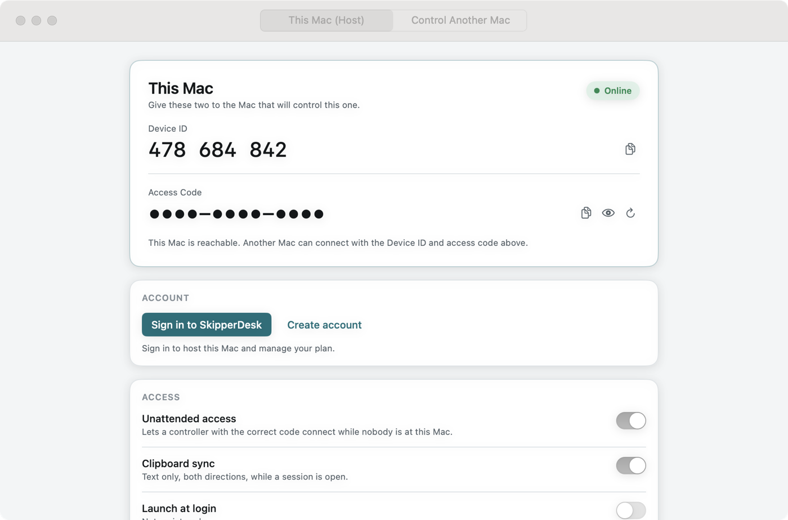
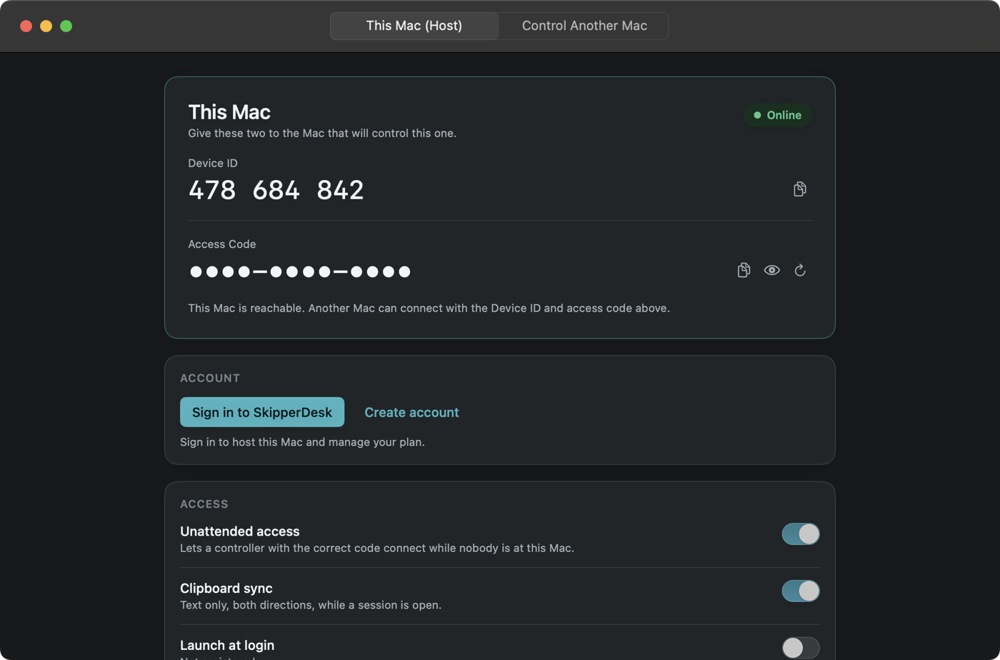
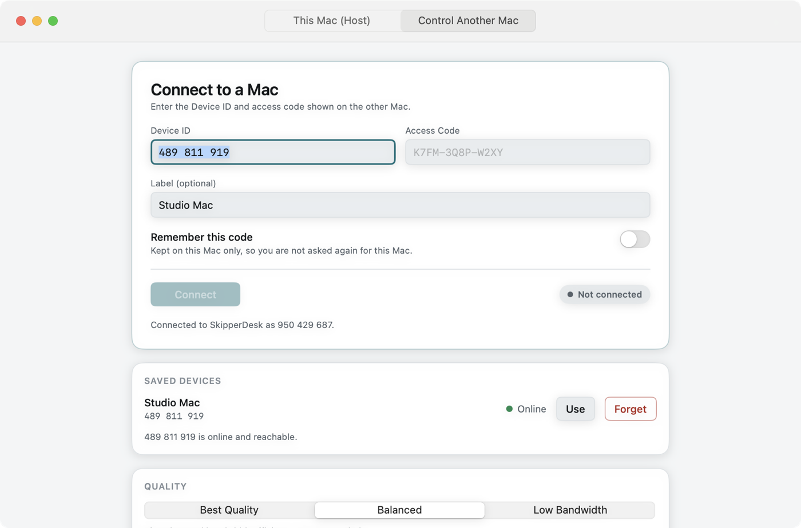
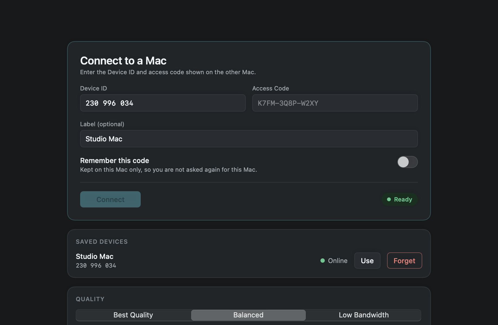
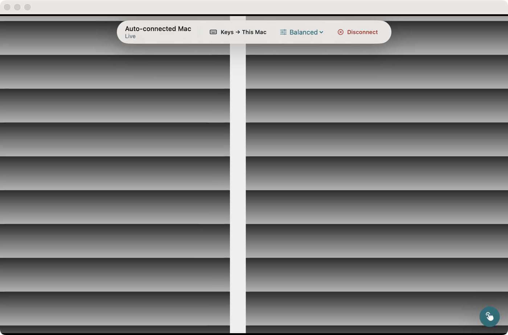
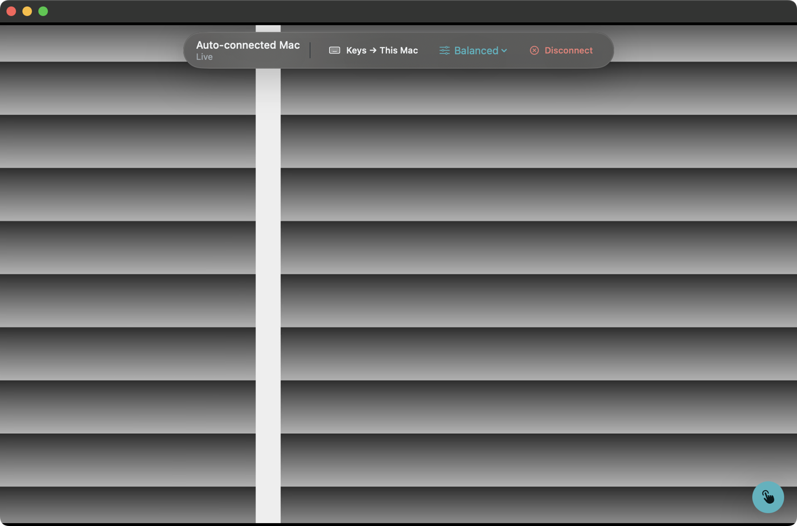

# SkipperDesk design system

One visual language, implemented natively per platform (SwiftUI in `apps/macos/Sources/SkipperDesign`,
WinUI later). This document is the source of truth; code follows it. No cross-platform UI toolkit.

Brand: **SkipperDesk**. One accent, **Harbor teal** — calm, nautical, not corporate blue.
System UI font everywhere (SF Pro / Segoe UI Variable); the system monospaced font (SF Mono /
Cascadia Mono) only for the Device ID, the access code and debug numbers.

## 1. Tokens

### Colour roles (sRGB hex; light / dark)

| Role | Light | Dark | Use |
|---|---|---|---|
| `canvas` | `#F3F5F6` | `#16191B` | Window background |
| `surface` | `#FFFFFF` | `#212528` | Cards, menu panel |
| `surfaceMuted` | `#EAEEF0` | `#282D31` | Text-field fill, hover, secondary button |
| `border` | `#DBE1E4` | `#33393E` | Card stroke, dividers |
| `borderStrong` | `#BFC8CD` | `#474F55` | Emphasised strokes |
| `textPrimary` | `#131719` | `#F1F4F5` | Titles, values |
| `textSecondary` | `#57626A` | `#A4AEB5` | Explanations, field labels |
| `textTertiary` | `#838D95` | `#79838B` | Section labels, footers |
| `accent` | `#0E6F7A` | `#45B4C0` | Primary action, focus, toggles, active state |
| `accentPressed` | `#0A555E` | `#67C7D1` | Pressed primary |
| `accentSoft` | `#DDEFF1` | `#123238` | Accent-tone pill/banner fill |
| `onAccent` | `#FFFFFF` | `#06191C` | Text on `accent` |
| `positive` / `positiveSoft` | `#1C8A52` / `#DFF1E7` | `#53C78C` / `#13301F` | Online, sharing |
| `attention` / `attentionSoft` | `#A76500` / `#FAECD8` | `#E2A951` / `#352612` | Connecting, reconnecting, missing permission |
| `critical` / `criticalSoft` | `#B02A22` / `#FAE3E1` | `#F08078` / `#3A1917` | Errors, destructive actions |
| `neutralSoft` | `#E6EAEC` | `#2B3034` | Offline / idle pill fill |
| `stage` | `#0B0D0E` | `#0B0D0E` | Behind the remote desktop (never themed) |
| `scrim` | black 62 % | black 62 % | Overlay card on the stage |

A **tone** is a (foreground, soft background) pair: `neutral` (textSecondary/neutralSoft),
`accent`, `positive`, `attention`, `critical`. Pills, banners and dots take a tone, never a raw colour.

### Type scale (points; system font unless noted)

| Token | Size / weight | Use |
|---|---|---|
| `display` | 28 semibold | Reserved (onboarding) |
| `title` | 20 semibold | Screen hero title ("This Mac", "Connect to a Mac") |
| `heading` | 15 semibold | Menu panel title, overlay title |
| `body` / `bodyEmphasis` | 13 regular / medium | Everything else; row titles, buttons |
| `callout` | 12 regular | Presence label, palette items |
| `caption` | 11 regular | Explanations, field labels |
| `sectionLabel` | 11 semibold, UPPERCASE, +0.6 tracking | Card titles |
| `codeHero` | 26 medium **mono** | Device ID and access code on the host |
| `code` / `codeCaption` | 13 / 11 regular **mono** | Entered codes, saved-device IDs, debug numbers |

Text wraps; it never truncates at the default window size. Only `codeHero` may shrink (to 60 %).

### Spacing, radii, elevation, layout

- Spacing scale: `xxs 2 · xs 4 · s 8 · m 12 · l 16 · xl 24 · xxl 32`. Card padding `l`, hero padding
  `xl`, gap between cards `l`, screen gutters `xl`.
- Radii: `small 6` (buttons, fields), `medium 10` (banners), `large 14` (cards, hero, overlays),
  `pill` (capsules).
- Elevation: `none`; `low` = black 10 %, blur 6, y 2 (cards); `high` = black 24 %, blur 24, y 10
  (floating session chrome, overlays).
- Window: default **920 × 600**, minimum 720 × 520. Content column max **720** wide, centred.

### Motion

| Token | Curve | Use |
|---|---|---|
| `quick` | ease-out 120 ms | Press, hover, focus ring, "Copied" |
| `standard` | ease-in-out 200 ms | Pill text change, palette open, overlay fade |
| `gentle` | ease-in-out 320 ms | Larger layout changes |
| `toolbarReveal` | ease-out 200 ms, 24 pt slide | Session toolbar in/out; hides 2 s after the pointer leaves |

## 2. Components

- **Window shell** — one window. Unified toolbar, no title; its centre holds the role switch (a
  two-segment control: "Share this Mac" / "Connect to a Mac"). Hidden during a session or an
  identity failure. Body: `canvas`, a scrolling centred column of cards.
- **Hero** — `surface` card with a 35 %-accent stroke, `xl` padding. Title + one-line caption at
  top-left, the screen's single status pill top-right.
- **Section card** — `surface`, `border` stroke, `large` radius, `low` elevation; optional
  UPPERCASE `sectionLabel` title and a right-aligned accessory.
- **Row** — title (`bodyEmphasis`) over a subtitle (`caption`, optionally mono), trailing controls.
  Rows in a card are separated by a 1 pt `border` divider.
- **Toggle row** — row with a switch on the right, tinted `accent`.
- **Buttons** — `bodyEmphasis`, 12 × 7 padding, `small` radius. *Primary*: accent fill, onAccent
  text (one per area). *Secondary*: surfaceMuted fill + border. *Quiet*: accent text, no fill.
  *Destructive*: critical text + 50 % critical stroke; always behind a confirmation. Disabled = 45 % opacity.
  *Icon button*: 24 pt square, textSecondary glyph, accent + muted fill on hover, always has a tooltip.
- **Status pill** — capsule, tone background, 7 pt tone dot + `caption` semibold tone text.
- **Presence dot** — 8 pt tone dot + `callout` label.
- **Code display** — `caption` label, then the value in `codeHero`, then trailing icon buttons:
  Copy (always; shows "Copied" in positive for 1.5 s), and for the access code Show/Hide and Refresh.
  A masked code shows `••••-••••-••••` and is not selectable, but still copies.
- **Text field** — `caption` label above; `surfaceMuted` fill, `border` stroke, `small` radius;
  focus = 2 pt `accent` stroke. Codes use `code` (mono). Access code is a secure field.
- **Banner** — `medium` radius, tone-soft fill, 35 % tone stroke; glyph, title (`bodyEmphasis`),
  optional message (`caption`), actions on the right (primary first).
- **Account block** — signed out: a single primary action, "Sign in to SkipperDesk", and one
  sentence, "Sign in to host this Mac and manage your plan." The website decides whether the
  person is new and handles sign-up itself; the app never offers a separate "create account"
  path. In progress: small spinner, "Continue in your browser…", quiet Cancel. Signed in: 36 pt
  accent avatar with the account's initial, the account label, the plan line, a tertiary
  "This Mac: <name>" line, and "Sign Out…" inside an ellipsis menu (confirmed by an alert). Error: one
  critical sentence + "Try again". Controllers never need to sign in.
- **Menu-bar menu** — a 280 pt `surface` panel: "SkipperDesk" (`heading`) + status pill, Device ID
  (mono), one state line, divider, the account row ("Sign In…", or avatar + label and "Sign Out…"),
  divider, then actions as full-width rows with a glyph (hover = muted fill):
  Open SkipperDesk (⌘O), Disconnect Session (disabled with no session), Quit (⌘Q). While a consent
  prompt is open, its menu style replaces the state line.
- **Session chrome** — the remote desktop fills the window on `stage`. A floating capsule toolbar
  (ultra-thin material, `high` elevation) is centred at the top: peer name + state line, capture-mode
  toggle (accent fill when keys go to the remote), quality menu, Disconnect (critical text, ⌘.).
  It shows on entry, while the pointer is within 56 pt of the top edge or over the toolbar, while
  waiting for video and while reconnecting; otherwise it hides after 2 s. The gesture palette is a
  40 pt accent circle bottom-right that opens a material list of gestures. Keyboard capture draws a
  3 pt accent frame round the stage.
- **Consent prompt** (`SkipperConsentPrompt`) — asks the host's owner whether a controller that
  has just proved the access code may connect. Raised-hand glyph in `accent`, title "Allow
  <controller> to control this Mac?" (the trusted-controller label, else "another Mac"), a
  `caption` sentence saying the code was entered and that no answer declines, then one detail
  line in `codeCaption` naming the controller plainly: its Device ID ("Device ID 123 456 789").
  Its key fingerprint ("Fingerprint F660 085E 05D4 830E" — the first four groups of four uppercase
  hex digits of SHA-256 over the controller's canonical key, the same text that Mac shows as "This
  Mac's fingerprint", so the owner can compare the two) sits behind the Details disclosure, never
  in normal view. When this prompt replaced one that was
  still open, a semibold `caption` notice in `attention` sits above the sentence: "A different
  request replaced the previous one." Then an `attention` status pill with the live countdown
  ("Declines in 30 seconds") and two buttons on the right: *Decline* (secondary, Esc) and *Allow*
  (primary, no Return shortcut, so a stray keypress never lets anyone in). *Allow* stays disabled
  for the first 1.5 s the prompt is on screen, and a click before then is refused, not remembered. Two styles: **window** — `surface`,
  35 %-accent stroke, `large` radius, `high` elevation, `xl` padding, centred at most 440 pt wide
  over a `scrim` that covers the whole window whatever screen is showing; **menu** — the same
  content on `accentSoft` with `m` padding, at the top of the menu-bar panel in place of the
  state line. When a prompt opens the app comes to the front and opens its window, the menu-bar
  glyph becomes a raised hand, and, if SkipperDesk is not the frontmost app, macOS shows a
  time-sensitive notification with the same title (permission is asked the first time; if it is
  refused the window prompt still appears). Only one prompt is ever open; answering in either
  place closes both.
- **Details disclosure** (`SkipperDetails`) — a quiet, collapsed `caption` "Details" row in
  `textTertiary` with a chevron that rotates on `standard`. Open, it lists `codeCaption` lines in
  `textTertiary`, selectable. It is the only place security and networking facts appear: the
  controller's fingerprint in the consent prompt and in a trusted-controller row, this Mac's own
  Device ID and fingerprint on the controller screen, the key-storage mechanics under the host
  screen, and the raw reason on the identity-failure screen. It shows nothing and takes no space
  when it has no lines.
- **Stage overlay card** — `scrim` fill, `large` radius, small spinner, `heading` title, `caption`
  message in white. Used for "waiting for video" and "Reconnecting…".

## 3. States

| State | Where | Presentation |
|---|---|---|
| Online | Host pill; saved device dot | positive, "Online" |
| Offline | Host pill; saved device dot | neutral, "Offline" + a sentence saying why |
| Connecting | Host pill; controller pill | attention, "Connecting…" + spinner beside Connect |
| Reconnecting | Host banner + pill; session overlay + toolbar | attention, "Reconnecting…", the session stays open |
| Session active | Host banner (with End Session) + pill; menu pill | accent, "Session active" / "Remote session active" |
| Error | Controller connect banner; account, capture, identity banners | critical banner, one plain sentence |
| Missing permission | Host only, only when missing | attention banner per permission: Open Settings + Ask macOS |
| Asking to connect | Host window overlay + menu panel (+ notification when in the background) | consent prompt with a 30 s countdown; no answer declines |
| Waiting to be accepted | Controller hero | attention note "Waiting for the other Mac to accept…", pill "Waiting…"; after a decline the critical banner "The other Mac declined the connection." |

**Unattended access** is a toggle row whose detail follows its state — on: "Anyone with the code
can connect without being asked here."; off: "You will be asked to allow each connection." It is
off on a new install (an existing install keeps what it had). While it is off the host hero carries
one extra note: "Leaving this Mac on its own? Turn on Unattended access below so connections do not
wait for someone to click Allow." The toggle decides consent and nothing else: keeping the Mac
awake follows being a reachable host, not this toggle, and the reachable note says so — "This Mac
is reachable. Another Mac can connect with the Device ID and access code above, and this Mac will
not fall asleep on its own while it is."

Nothing is shown for a healthy permission. Trusted controllers list each Mac with its label (the
Device ID formatted 3-3-3 until that Mac is named) and when it last connected, with its fingerprint
behind the row's Details disclosure; each row has a quiet destructive "Remove" for just that one (no
confirmation), and "Remove All…" forgets them all after a confirmation (Refresh also does).

## 4. Copy rules

1. **State, not telemetry.** "Sharing", "Reconnecting…", "Offline" — never bitrates, fps, RTT,
   pointer coordinates or resolutions. Those appear only when `RC_DEBUG=1`.
2. **Sentences, no jargon.** Say what happened and what to do: "Wrong access code. Check it on the
   other Mac." Not "auth_failed", "PAKE", "signaling", "TURN" in primary copy.
3. **No fluctuating numbers** unless `RC_DEBUG=1`. Static facts (Device ID, a balance, a trial end
   date) are fine.
4. **Sentence case** for titles, toggles and rows; Title Case only for button verbs. Ellipsis (…)
   on any button that asks again.
5. **Say the consequence before destroying**: every destructive confirmation states who loses access.
6. **Account vocabulary:** say "sign in" / "sign out" / "plan". Never "link", "unlink", "token" or
   "device key" in user-facing text. The app never says "create account" or offers a sign-up
   action of its own — signing in always goes to the website, which decides whether the person
   is new.
7. The product name is always "SkipperDesk"; the other computer is "the other Mac" / "this Mac".
8. **No security or networking internals in normal view.** A fingerprint, key, keychain, token,
   certificate, handshake, session id, "Secure Enclave", "entitlement", ICE/TURN/SDP/PAKE or any
   hex/base64 blob never appears on a screen the owner reads in normal use: it is jargon, and it
   advertises our internals to anyone looking over their shoulder. The **Details disclosure** is
   where those facts live, and `RC_DEBUG=1` is where the rest goes. The one exception is a warning
   the person must act on — a saved Mac whose identity changed — which is written in plain words
   and carries no jargon around it.
9. **Never narrate our own infrastructure.** Backend resets, re-registration, reassigned ids,
   migrations and key moves are logged, not shown. The UI shows the current state (the Device ID
   on screen is simply the right one); a notice appears only when the person must act and can
   act. Messages that reveal how much the service can change on someone's Mac erode trust.

## 5. App icon

Rounded square (824/1024 body, radius 185) with a vertical Harbor gradient `#1A8A96 → #0A4F58`; a
white compass ring (radius 250, stroke 34) with four short round-capped ticks, and a kite needle
pointing north-east (solid white north half, 45 % white south half). No text, no anchor.
Source PNGs: `apps/macos/Resources/AppIcon.iconset` (compiled by `scripts/build.sh`).

## 6. Screens (reference screenshots)

| Screen | Light | Dark |
|---|---|---|
| Host |  |  |
| Controller |  |  |
| Session |  |  |

Host: hero (Device ID, access code with Copy/Show/Refresh, status pill), permission banners when
needed, Account (sign in), Access toggles (unattended, clipboard, launch at login, install updates automatically), the "ready to update" banner when a verified update is staged, Screen sharing state,
Trusted controllers, Quality, key-storage footer. That footer says nothing at all when this Mac
holds its credentials the strongest way it can; when anything is weaker it shows one plain
sentence, "This Mac can't protect its credentials as strongly as usual." — never a claim of the
strongest storage when it fell back. Its Details disclosure carries the mechanics either way.
Controller: hero form (Device ID, access code, label, Remember, Connect, state pill, failure
banner, then a Details disclosure holding this Mac's Device ID and its fingerprint "This Mac's
fingerprint F660 085E 05D4 830E" — the line a host owner compares with the prompt's "Fingerprint"
line), Saved devices with presence, Quality.
Session: full-window desktop with the floating toolbar and gesture palette.
